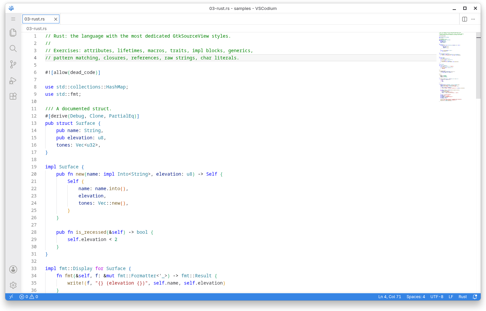
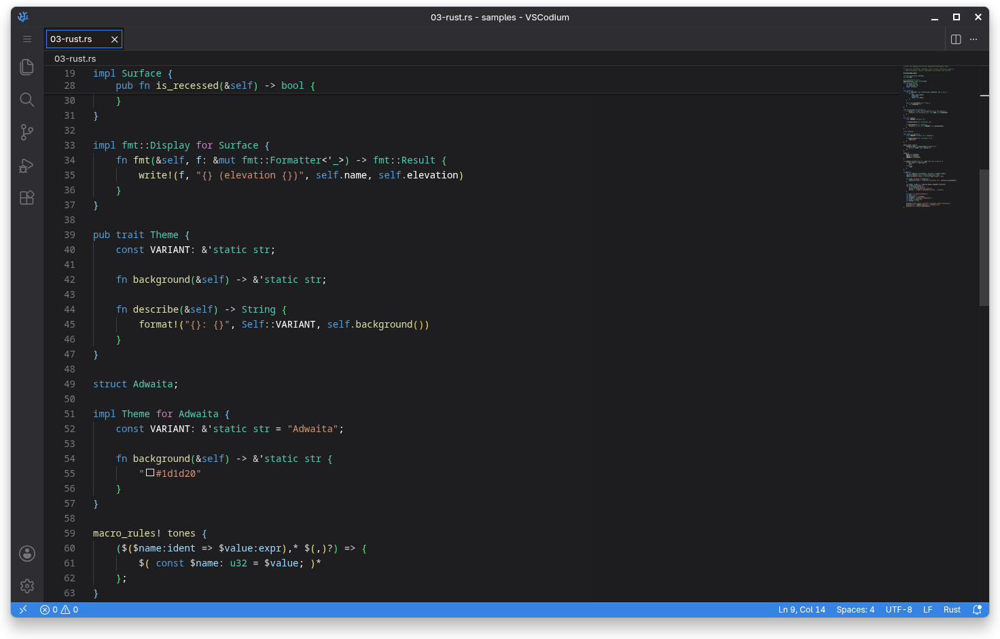

# VSC Adwaita Next

A GNOME Adwaita inspired theme for VS Code, VSCodium and other Code - OSS based editors.

VSC Adwaita Next is a **community maintained fork** of
[piousdeer/vscode-adwaita](https://github.com/piousdeer/vscode-adwaita). It
carries forward the original project's design while replacing its build
tooling, refreshing its design tokens against current libadwaita, and
extending its colour and syntax coverage.

This project is **not** the official continuation of the upstream repository,
and it is not affiliated with or endorsed by GNOME, Microsoft, or the upstream
maintainer.

- **Upstream project:** [piousdeer/vscode-adwaita](https://github.com/piousdeer/vscode-adwaita), created and maintained by piousdeer.
- **This fork:** independent maintenance, modernisation and release work.
- **Licence:** GPL-3.0-only, unchanged from upstream.

## Screenshots

Both images show the same file, `samples/03-rust.rs`, using the
**default syntax highlighting & colorful status bar** variants. The Adwaita
workbench colours are in use in both; only the token colours come from VS Code's
built-in Dark Plus and Light Plus.

| Adwaita Light                                                    | Adwaita Dark                                                   |
| ---------------------------------------------------------------- | -------------------------------------------------------------- |
|  |  |

## Features

- **Light and dark themes** built from libadwaita's own semantic surface tokens
  (`window`, `view`, `sidebar`, `headerbar`, `card`, `dialog`, `popover`) rather
  than hand-picked hex values.
- **Eight theme variants** covering every combination of light/dark, Adwaita or
  default syntax highlighting, and a neutral or colourful status bar.
- **GNOME Builder inspired syntax highlighting** translated from the GtkSourceView
  Adwaita style schemes, extended to cover the languages listed below.
- **Semantic token colours** so language servers colour code consistently with
  the TextMate rules instead of falling back to VS Code's defaults.
- **A product icon theme** with an Adwaita icon font for the window controls and
  layout switcher.
- **Deterministic generation.** Every theme file is produced by a typed
  TypeScript build from a single source of truth, so the eight files can never
  drift apart.

### What the theme does not do

This is a VS Code theme extension. It restyles the parts of the editor that VS
Code exposes through its theming API; it does not, and cannot, turn VS Code into
a native GTK4/libadwaita application. For CSS level integration, the upstream
community project
[wroyca/vscode-libadwaita](https://github.com/wroyca/vscode-libadwaita) remains
the place to look, and using it requires the
[Custom CSS and JS Loader](https://marketplace.visualstudio.com/items?itemName=be5invis.vscode-custom-css)
extension, which patches the editor at runtime and is not covered here.

## Themes

| Variant                                                           | Syntax highlighting | Status bar          |
| ----------------------------------------------------------------- | ------------------- | ------------------- |
| Adwaita Dark                                                      | Adwaita             | neutral             |
| Adwaita Dark & colorful status bar                                | Adwaita             | coloured by context |
| Adwaita Dark & default syntax highlighting                        | VS Code defaults    | neutral             |
| Adwaita Dark & default syntax highlighting & colorful status bar  | VS Code defaults    | coloured by context |
| Adwaita Light                                                     | Adwaita             | neutral             |
| Adwaita Light & colorful status bar                               | Adwaita             | coloured by context |
| Adwaita Light & default syntax highlighting                       | VS Code defaults    | neutral             |
| Adwaita Light & default syntax highlighting & colorful status bar | VS Code defaults    | coloured by context |

The "default syntax highlighting" variants keep the Adwaita workbench colours
but use VS Code's own token colours, for anyone who prefers the syntax palette
they already know. Those variants ship VS Code's built-in Dark Plus and Light
Plus token colours, refreshed from a current release rather than the 1.65.2
snapshot the upstream repository vendored.

### Colour hierarchy

The workbench palette follows libadwaita's surface elevation. In dark style the
content view is _darker_ than the chrome around it, which is how libadwaita
signals a recessed content area:

```
view (editor)  <  window  <  sidebar backdrop  <  sidebar / headerbar
              <  card  <  dialog / popover  <  thumbnail
```

Borders are a low-opacity tint of the foreground over the surface, exactly as
libadwaita derives `*_border_color` from `*_fg_color`.

### Syntax coverage

Adwaita syntax highlighting covers TypeScript and JavaScript, TSX and JSX, Rust,
Python, Go, C and C++, Java and Kotlin, C#, Ruby, PHP, Swift, Dart, shell
scripts including Bash and Fish, HTML and XML, CSS, SCSS and Less, JSON, JSONC,
YAML and TOML, Markdown, SQL, GraphQL, Dockerfiles, Nix, Lua and Zig. See
[CONTRIBUTING.md](CONTRIBUTING.md) for how the scope map is organised.

## Installation

### VS Code

Open the Extensions view (`Ctrl+Shift+X`), search for **VSC Adwaita Next**, and
install. Then run **Preferences: Color Theme** (`Ctrl+K Ctrl+T`) and pick one of
the eight Adwaita variants.

To install a VSIX built from this repository:

```bash
code --install-extension dist/vsc-adwaita-next-1.0.0.vsix
```

### VSCodium

VSCodium uses the [Open VSX Registry](https://open-vsx.org/) instead of the
Visual Studio Marketplace. Install from there:

```bash
codium --install-extension vsc-adwaita-next.vsc-adwaita-next
```

or from a VSIX built from this repository:

```bash
codium --install-extension dist/vsc-adwaita-next-1.0.0.vsix
```

### Enabling the product icon theme

Run **Preferences: Product Icon Theme** and choose **Adwaita**, or set it
directly:

```jsonc
"workbench.productIconTheme": "adwaita"
```

## Recommended settings

Open the Command Palette and run **Preferences: Open Settings (JSON)**. These
settings complement the theme:

```jsonc
"window.titleBarStyle": "custom",
"window.commandCenter": true,
"window.autoDetectColorScheme": true,
"workbench.preferredDarkColorTheme": "Adwaita Dark",
"workbench.preferredLightColorTheme": "Adwaita Light",
"workbench.productIconTheme": "adwaita",
"editor.renderLineHighlight": "none",
"workbench.tree.indent": 12
```

Two optional settings that suit the theme well:

```jsonc
// Open files permanently instead of in a preview tab that the next click
// replaces. Preview tabs show their title in italics.
"workbench.editor.enablePreview": false,

// Keep the explorer list quiet, matching the flat look of libadwaita lists.
"workbench.list.smoothScrolling": false
```

`window.autoDetectColorScheme` together with the preferred theme settings makes
VS Code follow the GNOME light/dark preference automatically.

For rounded window corners on all windows, the
[Rounded Window Corners](https://extensions.gnome.org/extension/5237/rounded-window-corners/)
GNOME extension is the usual companion. It is a desktop extension, not part of
this project.

## Compatibility

| Editor                                 | Supported |
| -------------------------------------- | --------- |
| Visual Studio Code                     | `^1.85.0` |
| VSCodium                               | `^1.85.0` |
| Code - OSS and other compatible builds | `^1.85.0` |

The extension is a pure theme and product icon theme: it contributes no
activation events, no `main` entry point, and no runtime code. Colour keys that
a given editor version does not know are ignored, so an older build still loads
the theme and simply leaves newer surfaces unstyled.

## Building from source

Requirements: [Bun](https://bun.sh) 1.1 or newer. `nanoemoji` is only needed to
rebuild the icon font.

```bash
bun install          # install dev dependencies
bun run build        # regenerate themes/ and validate icons/
bun run validate     # full validation of manifest, themes, tokens and icons
bun run package      # produce dist/*.vsix
```

See [CONTRIBUTING.md](CONTRIBUTING.md) for the full development workflow.

## Contributing

Contributions are welcome. Start with
[CONTRIBUTING.md](CONTRIBUTING.md), which documents the token architecture, the
scope map, and the release process.

Please report bugs and design regressions through the repository's issue
tracker. Screenshots of both light and dark themes are appreciated.

## Licence

GPL-3.0-only. See [LICENSE](LICENSE) for the full text.

This project contains derived work from:

- **GNOME GtkSourceView** style schemes `Adwaita` and `Adwaita-dark`,
  Copyright (C) Christian Hergert, LGPL-2.1-or-later. Vendored under
  `src/gtksourceview/`.
- **libadwaita** design tokens, Copyright (C) the GNOME project, LGPL-2.1-or-later.
  Values recorded in `src/adwaita.ts`.
- **Visual Studio Code** built-in Dark Plus and Light Plus token colours,
  Copyright (c) Microsoft Corporation, MIT licensed. Recorded in
  `src/default-themes/vscode-defaults.json`.

## Disclaimer

VSC Adwaita Next is not affiliated with, endorsed by, or sponsored by the GNOME
Foundation, Microsoft, or the upstream author of
[piousdeer/vscode-adwaita](https://github.com/piousdeer/vscode-adwaita). GNOME,
Adwaita, libadwaita and GTK are trademarks of the GNOME Foundation. Visual
Studio Code is a trademark of Microsoft Corporation.
